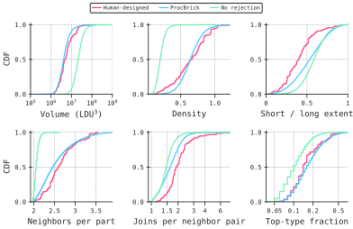
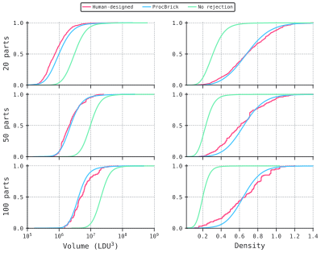
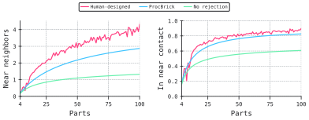

<div align="center">

# ProcBrick

Procedural brick assemblies for [BrickFlow](https://github.com/kulits/BrickFlow)


</div>

## Install

```bash
pip install procbrick
```

Sampling requires the assets with the connection atlas (1.11 GiB) and BrickNet's colliders (191 MiB download,
989 MiB extracted), which `fetch` downloads:

```bash
python -m procbrick fetch
```

Files are stored in `procbrick/` in BrickNet's data directory; set `BRICKNET_DATA` to move it.

## Data Structures

ProcBrick samples BrickNet `Tree`s: build orders in which part k + 1 attaches to an earlier part through a typed
edge at integer joint coordinates, so every prefix is connected and free of collisions. It stores them as:

- **Trees**: a directory of compressed records; any tree, or its first k parts, decodes alone.
- **Renders**: trees with print variants and colors, their cameras, and their images.

The **atlas** holds, for every pair of BrickNet connectors that can mate, the joint coordinates (integer degrees and
LDU) at which the two parts' BrickNet colliders do not collide. The sampler draws placements from it. BrickFlow's
connectivity energy also uses it to find valid seats.

```python
import bricknet
import procbrick

tree = procbrick.Sampler().sample()                                     # Tree of 100 parts
graph = bricknet.tree_to_graph(tree)                                    # Tree -> Graph

open("tree.txt", "w").write(bricknet.serialize_tree(tree))              # path text
open("tree.ldr", "w").write(bricknet.graph_to_ldr(graph))               # LDraw file
procbrick.save_trees([tree], "trees")                                   # directory of trees

trees = procbrick.load_trees("train/pt", [5, 2], parts=10)              # first 10 parts of trees 5 and 2

renders = procbrick.load_renders("val/procbrick")
tree = renders[0]                                                       # with print variants and colors
open("render.ldr", "w").write(bricknet.graph_to_ldr(bricknet.tree_to_graph(tree)))
open("render.avif", "wb").write(renders.image_bytes(0))                 # RGBA image
```

Modules:

- `sampler`: sampling trees, one at a time or many in parallel
- `trees`: reading and writing directories of trees
- `renders`: reading and writing renders
- `appearance`: print variants and colors of renders
- `catalog`: physical classes of parts
- `paths`: the data directory and `fetch`

## Command Line

```bash
python -m procbrick generate out --count 1000000   # a stopped run resumes
```

## BrickFlow Data

`fetch` also downloads BrickFlow's splits:

```bash
python -m procbrick fetch train/pt        # pretraining: 100,000,000 trees of 100 parts (19.4 GiB)
python -m procbrick fetch train/ic        # image-conditioned finetuning: 1,000,000 renders (100.5 GiB)
python -m procbrick fetch val/procbrick   # evaluation: 9,900 renders (1015 MiB)
```

## Distributions

The figures compare 100,000 sampled trees of 100 parts with the human-designed builds of BrickNet's SFT split. "No
rejection" shows stats of samples without the packing and connection-count acceptance.

Hull volume, density, short over long extent, neighbors per part, joins per neighbor pair, and the most common part
type's share, at 100 parts:



Volume and density of the first 20, 50, and 100 parts:



Near neighbors per part (parts no connection joins whose colliders come within 0.25 LDU) and the fraction of parts
with one, by part count:



## Scripts

```bash
python scripts/sample.py out --count 4   # trees with ProcBrick's appearance as LDraw files
python scripts/statistics.py --help      # the statistics above
```

## Data

The physical classes of parts ship inside the package. Assets and BrickFlow's splits are on Hugging Face
([kulits/BrickFlow](https://huggingface.co/datasets/kulits/BrickFlow)). See [DATA.md](https://github.com/kulits/ProcBrick/blob/master/DATA.md) for schemas.

## Citation

```bibtex
@InProceedings{kulits2026brickflow,
  author    = {Kulits, Peter and Schmid, Cordelia},
  title     = {BrickFlow: Connectivity-Guided Brick Reconstruction},
  booktitle = {Advances in Neural Information Processing Systems},
  year      = {2026}
}
```
